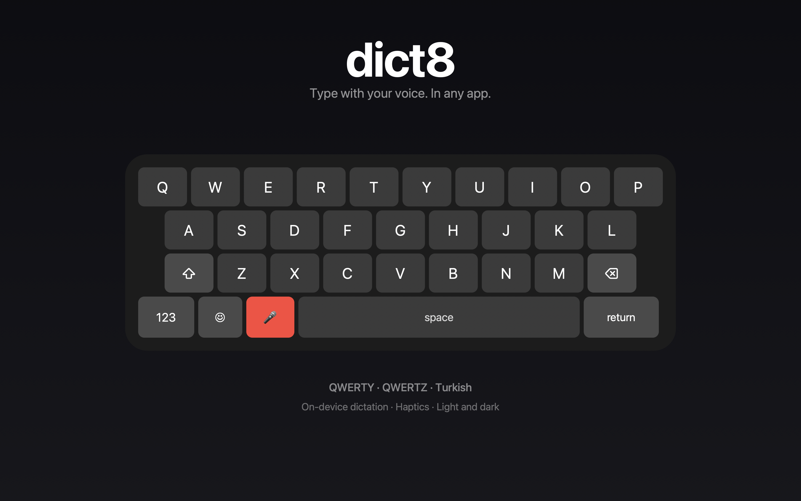

# dict8



A native iOS keyboard extension with on-device voice dictation. Type with your voice in any app — Messages, Notes, Safari, Mail — without switching apps or granting network access beyond what speech recognition needs.

## Features

- **Voice dictation** — tap the mic key, speak, text appears live as you talk. Partial results replace in place; final transcript commits cleanly.
- **Three layouts** — QWERTY, QWERTZ, and Turkish, selectable in the app or from the gear key on the keyboard.
- **?123 and #+= pages** — numbers, punctuation, and symbols, with the standard page switching.
- **Long-press accents** — ä ö ü ß, ğ ü ş ı ö ç and more, with one-shot shift support.
- **Shift and caps lock** — single press, double-tap for caps, auto-capitalise after sentence endings.
- **Haptics and key sounds** — both toggleable.
- **Light / dark / system** appearance, applied instantly.
- **Retuned return key** — shows go, search, send, done, etc. based on the host app.
- **Onboarding + test field** in the containing app, plus a settings panel on the keyboard itself.
- **App Group sharing** — layout, appearance, and toggles sync between the app and the extension.

## Requirements

- iOS 17.0+
- Xcode 15+
- A device with a microphone for dictation (simulator supports typing only)

## Install

1. Open `VoiceKeyboard.xcodeproj` in Xcode.
2. Select your development team in both targets (app + keyboard extension).
3. Build and run on a device.
4. On the device: **Settings → General → Keyboard → Keyboards → Add New Keyboard → dict8**, then tap it and enable **Allow Full Access** (required for the microphone).
5. In any text field, switch to dict8 with the globe key and tap the mic.

## Project layout

```
VoiceKeyboard/          # Containing app (SwiftUI onboarding + test field)
KeyboardExt/            # Keyboard extension (UIKit)
Shared/                 # Shared models + preferences (App Group)
docs/                   # Design spec + showcase image
scripts/                # Project and asset generators
VoiceKeyboard.xcodeproj
```

## Design

Key sizes, colours, spacing, and the Figma status are documented in [`docs/DESIGN.md`](docs/DESIGN.md). The showcase image is rendered from the same tokens by `scripts/make_showcase.swift`.

## Privacy

- Dictation prefers on-device speech recognition; falls back to network recognition only if the offline model is unavailable, and the status bar says so.
- The microphone is never granted to a non-local page; navigation is limited to the local capture page.
- Logs use `.private` for transcript and error text.
- No audio or text is stored or transmitted beyond what `SFSpeechRecognizer` requires.

## Security

See the security review notes: `RequestsOpenAccess` is required for microphone + speech recognition. If you want an offline-only build, set it to `false` in `KeyboardExt/Info.plist` and remove network entitlements.

## License

MIT — see [LICENSE](LICENSE).

## Credits

Built on top of [stephancill/ios-keyboard-dictation](https://github.com/stephancill/ios-keyboard-dictation). Native rewrite with layouts, ?123 page, haptics, appearance, onboarding, and hardening.